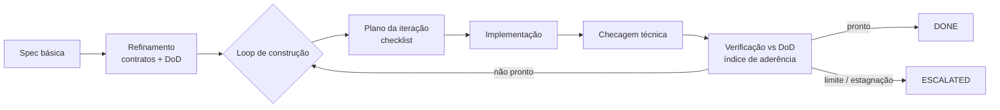
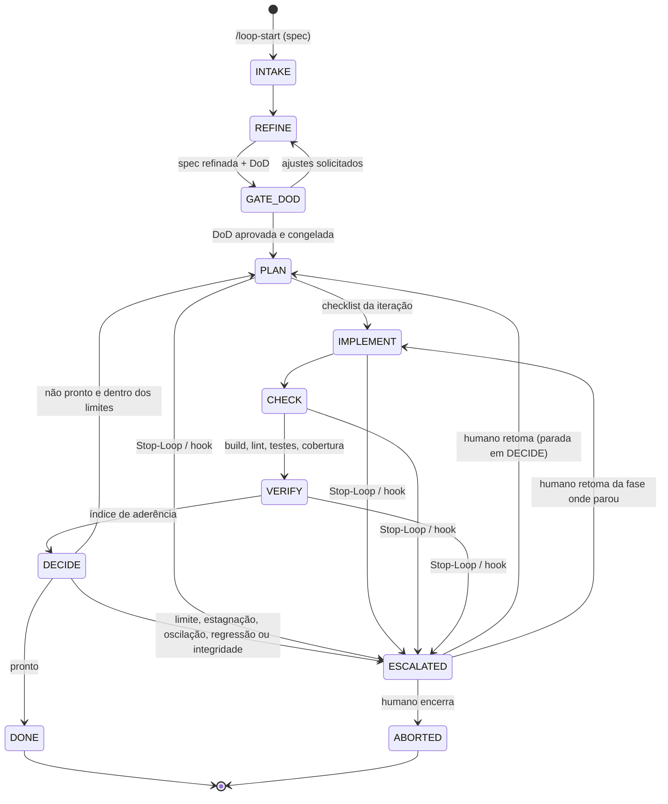
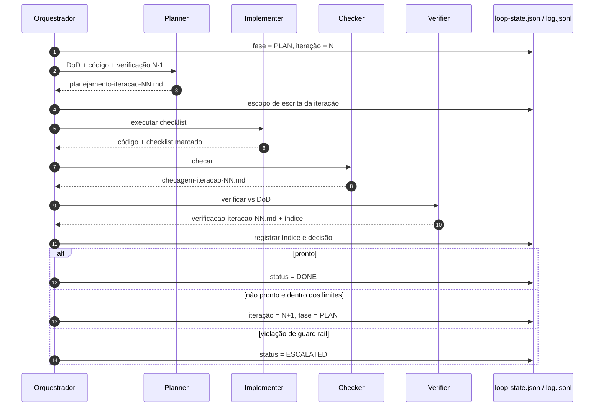
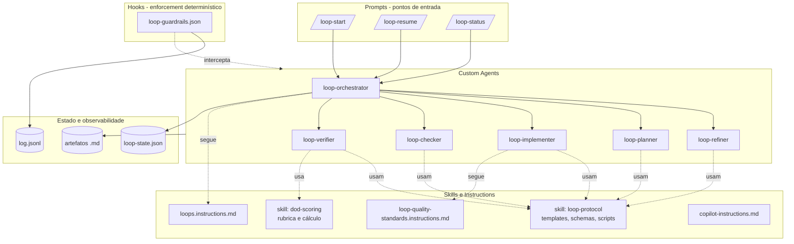

# Loop Engineering — Documento Base

> Modelo de engenharia de loops agênticos orientados a especificação, construído sobre as primitivas do GitHub Copilot (Agents, Skills, Instructions, Prompts e Hooks).
>
> **Status:** conceitual aprovado · **implementação v1 concluída** (seção 20) · recomendações R01–R21 avaliadas (seção 21) — pronta para o primeiro loop piloto.
> **Versão:** 1.3 · **Data:** 2026-11-09

---

## Sumário

1. [Visão geral](#1-visão-geral)
2. [Princípios de design](#2-princípios-de-design)
3. [Decisões aprovadas](#3-decisões-aprovadas)
4. [Ciclo de vida do loop](#4-ciclo-de-vida-do-loop)
5. [Fases em detalhe](#5-fases-em-detalhe)
6. [Arquitetura de primitivas GitHub Copilot](#6-arquitetura-de-primitivas-github-copilot)
7. [Estrutura de arquivos](#7-estrutura-de-arquivos)
8. [Padrões técnicos de qualidade](#8-padrões-técnicos-de-qualidade)
9. [Definição de pronto e índice de aderência](#9-definição-de-pronto-e-índice-de-aderência)
10. [Algoritmo de decisão](#10-algoritmo-de-decisão)
11. [Guard rails e harness](#11-guard-rails-e-harness)
12. [Observabilidade](#12-observabilidade)
13. [Esquemas de dados](#13-esquemas-de-dados)
14. [Templates dos artefatos](#14-templates-dos-artefatos)
15. [Especificação dos agentes](#15-especificação-dos-agentes)
16. [Especificação dos prompts, skills, instructions e hooks](#16-especificação-dos-prompts-skills-instructions-e-hooks)
17. [Plano de construção](#17-plano-de-construção)
18. [Riscos e limitações](#18-riscos-e-limitações)
19. [Glossário](#19-glossário)
20. [Implementação v1 — estado e uso](#20-implementação-v1--estado-e-uso)
21. [Recomendações avaliadas (R01–R21)](#21-recomendações-avaliadas-r01r21)
22. [Apêndice A — Roteiro para o PPTX](#apêndice-a--roteiro-para-o-pptx)

---

## 1. Visão geral

**Problema:** agentes de código produzem bons resultados em tarefas curtas, mas perdem direção em entregas maiores: não sabem quando parar, se autoavaliam com viés e não deixam rastro auditável.

**Proposta:** um **loop de engenharia** que:

1. recebe uma **especificação básica** via prompt;
2. **refina** essa especificação em um desenho (contratos de entrada, lógica, contratos de saída) e produz uma **Definição de Pronto (DoD)** mensurável;
3. entra em um **loop de construção** — *planejar → implementar → checar → verificar* — até atingir a DoD;
4. mede a cada iteração um **índice de aderência** à DoD;
5. encerra com **sucesso** (`DONE`) ou **escala para um humano** (`ESCALATED`), sempre dentro de **limites** e com **log completo** de todas as ações.



---

## 2. Princípios de design

| # | Princípio | Significado prático |
|---|---|---|
| P1 | **Estado em arquivos, não em memória** | Spec, DoD, planos, logs e `loop-state.json` vivem em `loops/`. O loop é retomável, auditável e reproduzível. |
| P2 | **Uma fase = um agente isolado** | Cada fase roda em subagente com contexto próprio e ferramentas mínimas. O orquestrador não acumula contexto. |
| P3 | **Quem implementa não se avalia** | O verificador é independente, sem permissão de edição, e só pontua com evidência. |
| P4 | **Harness determinístico > instruções** | Regras críticas (limites, imutabilidade, escopo, comandos perigosos, log) são impostas por hooks e scripts, não apenas pedidas ao modelo. |
| P5 | **DoD congelada** | Após aprovação humana, a DoD é um contrato imutável **dentro do loop**. Mudar regra, critério ou teste congelado exige um novo loop, com nova aprovação (D-17). |
| P6 | **Evidência ou zero** | Critério sem evidência objetiva (teste, saída de execução, relatório) pontua 0. |
| P7 | **Convergência obrigatória** | O loop precisa mostrar progresso mensurável; estagnação, oscilação ou regressão encerram com escalonamento. |
| P8 | **Processo separado do produto** | `loops/` guarda o processo; o código produzido vai para o repositório normalmente (`src/`, `tests/`). |
| P9 | **Ciclo autônomo, humano só fora dele** | Dentro do ciclo (PLAN → DECIDE), ninguém humano aprova ou avalia: o próprio loop produz a evidência, pontua e decide. O humano atua em três momentos: no GATE_DOD (antes da 1ª iteração), quando uma **condição de parada** é disparada (para retomar o loop do ponto onde parou, ou abortá-lo) e na revisão da entrega. |

---

## 3. Decisões aprovadas

| ID | Decisão | Valor |
|---|---|---|
| D-01 | Ambiente de execução | VS Code Chat (modo agente). Evolução futura: Copilot CLI orquestrado por script externo (opção B). |
| D-02 | Linguagem dos scripts do harness | PowerShell (ambiente Windows) |
| D-03 | Máximo de iterações | 5 |
| D-04 | Limiar do índice de aderência | 0,90 |
| D-05 | Checkpoints humanos | Somente fora do ciclo: aprovação da DoD (obrigatória) e retomada/aborto após uma condição de parada (`ESCALATED`). Nenhuma aprovação humana dentro das iterações |
| D-06 | Local da DoD | Nível do loop (contrato único), não por iteração |
| D-07 | Estado da máquina | `loop-state.json` legível por máquina |
| D-08 | Log | Duas camadas: `log.jsonl` (estruturado, via hooks) + `log-iteracao-NN.md` (narrativo, via agentes) |
| D-09 | Cobertura de testes | **100% de linhas e branches** sobre o escopo lógico + **rastreabilidade 100%** de fluxos lógicos para testes |
| D-10 | Padrões técnicos | Herdados automaticamente por toda DoD como critérios `PT-xx` (seção 8) |
| D-11 | Comandos técnicos | Definidos por loop na spec refinada e congelados no estado na aprovação da DoD |
| D-12 | Autonomia | O orquestrador continua sozinho entre gates humanos (hook `agentStop`, configurável em `loop-config.json`) |
| D-13 | Runtime dos scripts | PowerShell 7+ (`pwsh`), com os guard rails de `preToolUse` unificados num único script |
| D-14 | Condições de parada | Disparadas pelo próprio loop: pela decisão (limite, estagnação, oscilação, regressão, integridade da DoD), pelo orquestrador (`Stop-Loop.ps1`: impedimento, falha de protocolo) ou por hook (orquestrador interrompido). A fase e a iteração exatas ficam registradas em `parada` |
| D-15 | Retomada | O humano retoma do ponto de parada: parado em DECIDE → abre a próxima iteração; parado no meio de uma fase → volta para a mesma fase da mesma iteração |
| D-16 | Comandos restritos | Com o loop em andamento são **negados** (não há quem aprove no meio do ciclo); com o loop parado, pedem confirmação |
| D-17 | Contrato imutável após o GATE_DOD | Nenhuma regra de negócio, critério da DoD ou teste congelado muda no mesmo loop. A orientação de uma retomada é técnica (ambiente, dependências, abordagem); em conflito, prevalece a DoD. Paradas por motivo de contrato (`AMBIGUIDADE_REGRA`, `CONTESTACAO_CRITERIO`, `CONTESTACAO_TESTE`) não admitem retomada: o loop é abortado e um novo loop começa a partir da spec refinada revisada (`Initialize-Loop -LoopAnterior`), com novo GATE_DOD. A retomada também exige que 00/01/02 tenham o hash aprovado |

---

## 4. Ciclo de vida do loop

### 4.1 Máquina de estados



> Para não poluir o diagrama, só a retomada em IMPLEMENT aparece como exemplo. A retomada volta sempre à **fase e iteração exatas** da parada (`parada.fase`, `parada.iteracao` em `loop-state.json`).

### 4.2 Estados

| Estado | Responsável | Descrição |
|---|---|---|
| `INTAKE` | Orquestrador | Cria a estrutura do loop, grava a spec original, inicializa o estado. |
| `REFINE` | `loop-refiner` | Evolui a spec em desenho técnico e produz a DoD. |
| `GATE_DOD` | Humano | Aprova, ajusta ou rejeita a DoD. Ao aprovar, a DoD é congelada (hash). |
| `PLAN` | `loop-planner` | Gera o checklist da iteração a partir do gap entre DoD e código. |
| `IMPLEMENT` | `loop-implementer` | Executa todos os itens do checklist. |
| `CHECK` | `loop-checker` | Verifica saúde técnica (build, lint, testes, cobertura). |
| `VERIFY` | `loop-verifier` | Confere a implementação contra a DoD, executando o código quando necessário. |
| `DECIDE` | Orquestrador + script | Aplica o algoritmo de decisão (seção 10). |
| `DONE` | — | Terminal de sucesso. Gera `resultado-final.md`. |
| `ESCALATED` | Humano (fora do ciclo) | Condição de parada disparada pelo próprio loop. O humano não avalia a iteração: decide retomar do ponto de parada (com orientação e, se necessário, mais iterações) ou abortar. |
| `ABORTED` | — | Terminal sem sucesso, com motivo registrado. |

### 4.3 Sequência de uma iteração



---

## 5. Fases em detalhe

### 5.1 INTAKE
- **Entrada:** spec básica (texto inline ou arquivo), nome do loop, limites opcionais.
- **Ações:** executa `Initialize-Loop.ps1` → cria `loops/<loop-id>/`, grava `00-spec-original.md` (imutável), cria `loop-state.json` com limites de `.github/loop-config.json`, registra `loops/.active`.
- **Saída:** estrutura pronta, fase `REFINE`.

### 5.2 REFINE
- **Entrada:** `00-spec-original.md`, contexto do repositório.
- **Ações:** o refiner produz:
  - **Contratos de entrada (`CE-xx`)**: formato, tipos, obrigatoriedade, regras de validação.
  - **Regras de negócio (`RN-xx`)**.
  - **Fluxos lógicos (`FL-xx`)**: cada caminho de execução relevante, incluindo caminhos de erro.
  - **Contratos de saída (`CS-xx`)**: formato de sucesso e de erro.
  - **Escopo lógico**: caminhos de código sujeitos a cobertura 100% e lista justificada de exclusões.
  - **Premissas e questões em aberto**.
  - **DoD**: critérios funcionais `DOD-xx` + padrões técnicos herdados `PT-xx`.
- **Saída:** `01-spec-refinada.md`, `02-definicao-de-pronto.md`.

### 5.3 GATE_DOD (humano)
- Humano revisa spec refinada e DoD; responde questões em aberto.
- Antes do gate, `Set-LoopPhase.ps1 -Fase GATE_DOD` valida:
  - que não restam `<preencher`;
  - que existem critérios `DOD-xx`;
  - que os PT obrigatórios estão presentes.
- Aprovação → `Approve-LoopDod.ps1 -AprovadoPor <usuário>`, que executa:
  - grava os hashes SHA-256 de `00`/`01`/`02` em `loop-state.json` e marca `congelada: true`;
  - **congela os comandos técnicos** da spec refinada;
  - abre a `iteracao-01`.
- A partir daqui, os hooks negam edição de `00-*`, `01-*` e `02-*` e das configurações de cobertura existentes.

### 5.4 PLAN
- **Entrada:** DoD, código atual, `verificacao-iteracao-(N-1).md` (se houver).
- **Ações:** calcula o gap (critérios com pontuação < 1 e gates pendentes), prioriza, gera checklist. Cada item referencia ao menos um ID da DoD e declara arquivos-alvo.
- **Regras:** máximo de `max_itens_por_plano` itens; itens que corrigem regressão vêm primeiro; o plano declara o **escopo de escrita** (globs).
- **Saída:** `planejamento-iteracao-NN.md` (devolvido ao orquestrador, que o persiste). `Set-LoopPhase.ps1 -Fase IMPLEMENT` valida o formato dos itens, as referências à DoD e o limite de itens, e registra o escopo de escrita no estado.

### 5.5 IMPLEMENT
- **Entrada:** plano da iteração.
- **Ações:** executa os itens em ordem; marca cada um como `[x]` concluído, `[~]` com desvio ou `[!]` bloqueado; registra desvios em `log-iteracao-NN.md`. Escreve testes junto com o código, referenciando IDs (`FL-xx`, `CE-xx`...).
- **Restrições:** só escreve dentro do escopo declarado; não altera configuração de cobertura/limiares; não enfraquece testes existentes sem item explícito no plano.
- **Saída:** código + checklist marcado.

### 5.6 CHECK (técnico)
- **Pergunta:** *"o código está saudável?"*
- **Ações:** executa, na ordem: restore → build (warnings como erro) → lint/format → testes → cobertura (linhas e branches) → análise estática/dependências.
- **Saída:** `checagem-iteracao-NN.md` com status por etapa (`VERDE`/`VERMELHO`), números e trechos relevantes de erro.

### 5.7 VERIFY (aderência)
- **Pergunta:** *"entregamos o que a DoD exige?"*
- **Ações:** para cada critério da DoD, coleta evidência pelo método definido (teste, execução real, inspeção, contrato), atribui pontuação 0 / 0,5 / 1 e justifica. Executa o código quando o método exigir (smoke, chamadas reais aos contratos). Confere o hash da DoD.
- **Saída:** `verificacao-iteracao-NN.md` com a matriz critério × evidência × pontuação. O índice oficial é calculado por `Measure-Adherence.ps1` na fase DECIDE, sempre com os pesos e gates da DoD.

### 5.8 DECIDE
- Aplica o algoritmo da seção 10 com base em `loop-state.json` e na verificação.
- Registra a decisão e o motivo; avança para `PLAN`, `DONE` ou `ESCALATED`.

### 5.9 Condições de parada e retomada
Nenhuma pessoa avalia ou aprova nada dentro do ciclo. Quando o loop não pode ou não deve prosseguir, ele próprio dispara uma **condição de parada** e vai para `ESCALATED`, registrando o ponto exato (`parada.fase`, `parada.iteracao`, `motivo`, `detalhe`).

| Origem | Motivos | Fase registrada | Retomada no mesmo loop |
|---|---|---|---|
| Algoritmo de decisão (`Invoke-LoopDecision`) | `LIMITE_ITERACOES`, `ESTAGNACAO`, `OSCILACAO`, `REGRESSAO` | `DECIDE` | Sim |
| Algoritmo de decisão | `INTEGRIDADE_DOD` | `DECIDE` | Só depois de restaurar a DoD aprovada (hash) |
| Orquestrador (`Stop-Loop.ps1`) — operacional | `IMPEDIMENTO` (ambiente, dependência), `FALHA_PROTOCOLO` (script/subagente falhou após 2 tentativas) | Fase corrente | Sim |
| Orquestrador (`Stop-Loop.ps1`) — contrato | `AMBIGUIDADE_REGRA` (a spec/DoD não define uma regra necessária), `CONTESTACAO_CRITERIO` (critério contraditório ou impossível) | Fase corrente | **Não** (D-17): abortar e abrir um novo loop |
| Hook `agentStop` | `ORQUESTRADOR_INTERROMPIDO` (encerrou o turno 3 vezes na mesma fase) | Fase corrente | Sim |

**Ambiguidade durante as iterações:**
- **Técnica** (como implementar): o loop adota a opção mais simples compatível com a DoD, registra a premissa e segue.
- **De regra de negócio ou de critério:** nenhum agente assume. O loop para imediatamente com `AMBIGUIDADE_REGRA`, sem esperar os guard rails de convergência.

O humano retoma com `/loop-resume continuar [+N]: <orientação técnica>` (`Resolve-LoopEscalation.ps1 -Decisao Continuar`), ou encerra com `abortar`:
- **Parada em DECIDE** (iteração já avaliada): abre a próxima iteração em PLAN e amplia `max_iteracoes` se o limite tiver sido atingido.
- **Parada no meio de uma fase:** volta para a **mesma fase da mesma iteração**. Em IMPLEMENT, o escopo de escrita é recalculado a partir do plano.
- A parada vai para o histórico `paradas` (quem retomou, quando e com qual orientação). Os contadores de oscilação são zerados, e estagnação e regressão passam a considerar só as iterações avaliadas depois da retomada.

**Nova versão do contrato (D-17):** depois de abortar, `/loop-start <nome>-v2 <decisão sobre a regra> anterior=<loop-id>` (`Initialize-Loop.ps1 -LoopAnterior`):
- a spec de entrada do novo loop combina a decisão humana com a spec refinada do loop anterior;
- o novo loop passa por REFINE e por um novo GATE_DOD;
- o código já produzido continua no repositório e é o ponto de partida do planejamento;
- os dois loops ficam ligados por `loop_anterior` e `substituido_por`.

---

## 6. Arquitetura de primitivas GitHub Copilot

### 6.1 Visão geral



### 6.2 Papel de cada primitiva

| Primitiva | Natureza | Uso no loop |
|---|---|---|
| **Prompts** (`*.prompt.md`) | Ponto de entrada parametrizado (slash command) | Iniciar, retomar e consultar loops |
| **Custom Agents** (`*.agent.md`) | Persona com ferramentas restritas, contexto isolado | Orquestrador + 5 subagentes de fase |
| **Skills** (`SKILL.md` + assets) | Workflow sob demanda com templates e scripts | Protocolo do loop e rubrica de pontuação |
| **Instructions** (`*.instructions.md`) | Diretrizes aplicadas por `applyTo` ou sob demanda | Convenções de artefatos e padrões técnicos |
| **copilot-instructions.md** | Diretriz sempre ativa | Mínimo: stack e comandos do projeto |
| **Hooks** (`*.json`) | Execução determinística em eventos do ciclo de vida | Limites, imutabilidade, escopo, comandos bloqueados, log |

### 6.3 Regras de composição
- Subagentes usam `user-invocable: false`: só o orquestrador os aciona.
- O orquestrador declara `agents:` com exatamente os 5 subagentes.
- Cada agente recebe o **mínimo de ferramentas** do seu papel (seção 15).
- Instructions *orientam*; hooks *garantem*. Toda regra crítica existe nos dois lugares.

---

## 7. Estrutura de arquivos

### 7.1 Customizações (repositório)

```
.gitignore                                  # estado local do harness (.active, marcadores)
specs/
├── README.md                               # como escrever e iniciar uma spec
└── TEMPLATE-spec.md                        # modelo de spec de entrada
loops/
└── README.md                               # estrutura de um loop
.github/
├── copilot-instructions.md                 # visão do repositório e convenções
├── loop-config.json                        # limites, autonomia, caminhos protegidos, padrões de comandos
├── agents/
│   ├── loop-orchestrator.agent.md          # + hook agentStop (continuidade)
│   ├── loop-refiner.agent.md
│   ├── loop-planner.agent.md
│   ├── loop-implementer.agent.md
│   ├── loop-checker.agent.md
│   └── loop-verifier.agent.md
├── prompts/
│   ├── loop-start.prompt.md
│   ├── loop-resume.prompt.md
│   └── loop-status.prompt.md
├── instructions/
│   ├── loops.instructions.md               # applyTo: loops/**
│   └── loop-quality-standards.instructions.md
├── skills/
│   ├── loop-protocol/
│   │   ├── SKILL.md
│   │   ├── templates/
│   │   │   ├── spec-refinada.md
│   │   │   ├── definicao-de-pronto.md      # já contém a baseline PT-01..PT-14
│   │   │   ├── planejamento-iteracao.md
│   │   │   ├── checagem-iteracao.md
│   │   │   ├── verificacao-iteracao.md
│   │   │   ├── log-iteracao.md
│   │   │   └── resultado-final.md
│   │   ├── schemas/
│   │   │   ├── loop-state.schema.json
│   │   │   └── log-event.schema.json
│   │   ├── scripts/
│   │   │   ├── LoopCommon.psm1             # funções compartilhadas (estado, log, glob, parsers)
│   │   │   ├── Initialize-Loop.ps1         # INTAKE → REFINE
│   │   │   ├── Set-LoopPhase.ps1           # transições validadas
│   │   │   ├── Approve-LoopDod.ps1         # GATE_DOD → PLAN (humano)
│   │   │   ├── Invoke-LoopDecision.ps1     # VERIFY → DECIDE → PLAN/DONE/ESCALATED
│   │   │   ├── Stop-Loop.ps1               # condição de parada disparada pelo loop
│   │   │   ├── Resolve-LoopEscalation.ps1  # ESCALATED → fase onde parou / ABORTED (humano)
│   │   │   ├── Set-ActiveLoop.ps1
│   │   │   ├── Write-LoopEvent.ps1
│   │   │   └── Get-LoopStatus.ps1
│   │   └── tests/
│   │       └── Test-LoopHarness.ps1        # auto-teste do ciclo completo e dos hooks
│   └── dod-scoring/
│       ├── SKILL.md
│       ├── rubrica.md
│       └── scripts/
│           └── Measure-Adherence.ps1
└── hooks/
    ├── loop-guardrails.json                # eventos camelCase do harness Copilot
    └── scripts/
        ├── HookCommon.psm1                 # leitura do payload, extração de caminhos/comandos
        ├── Test-LoopGuardrails.ps1         # preToolUse: todos os guard rails num único processo
        ├── Write-HookEvent.ps1             # sessionStart/End, postToolUse(Failure), subagentStart/Stop
        └── Test-LoopContinuation.ps1       # agentStop do orquestrador
```

> **Ajuste em relação ao desenho conceitual:** os quatro scripts de `preToolUse` previstos (limite, caminhos protegidos, escopo, comandos) foram unificados em `Test-LoopGuardrails.ps1`. Cada hook inicia um processo `pwsh` (~1,3 s), e quatro processos por chamada de ferramenta seriam lentos demais.

### 7.2 Execução de um loop

```
loops/
├── .active                                  # id do loop ativo (lido pelos hooks)
└── loop-funcionalidade-x/
    ├── loop-state.json                      # fase, iteração, limites, histórico, status
    ├── log.jsonl                            # eventos estruturados (append-only)
    ├── 00-spec-original.md                  # entrada original (imutável)
    ├── 01-spec-refinada.md                  # CE, RN, FL, CS, escopo lógico, premissas
    ├── 02-definicao-de-pronto.md            # DOD-xx + PT-xx (congelada após gate)
    ├── iteracao-01/
    │   ├── planejamento-iteracao-01.md
    │   ├── checagem-iteracao-01.md
    │   ├── verificacao-iteracao-01.md
    │   └── log-iteracao-01.md
    ├── iteracao-02/ ...
    └── resultado-final.md
```

### 7.3 Regras de imutabilidade

| Artefato | Mutável até | Garantido por |
|---|---|---|
| `00-spec-original.md` | Criação | Hook `Test-LoopGuardrails` (caminho protegido) |
| `01-spec-refinada.md`, `02-definicao-de-pronto.md` | Aprovação no `GATE_DOD` | Hook + hash SHA-256 em `loop-state.json` (conferido no VERIFY/DECIDE) |
| `iteracao-NN/*` | Fim da iteração N (decisão registrada) | Hook (iterações anteriores e ainda não abertas) |
| `log.jsonl` | Sempre apenas append | Escrito só por scripts e hooks |
| `loop-state.json`, `loops/.active` | Sempre, apenas via scripts | Hook nega edição direta (ferramentas de edição e shell) |
| Configurações de cobertura existentes | Aprovação no `GATE_DOD` | Hook (`configuracoes_cobertura` em `loop-config.json`) |
| `.github/hooks/**`, scripts do protocolo, `loop-config.json` | Sempre protegidos durante o loop | Hook |

---

## 8. Padrões técnicos de qualidade

Os padrões técnicos são **critérios herdados automaticamente por toda DoD**, com prefixo `PT-xx`. A DoD de um loop pode **endurecê-los**, mas **nunca afrouxá-los** sem aprovação humana explícita registrada no `GATE_DOD`.

### 8.1 Cobertura de 100% do fluxo lógico

A cobertura é exigida em **duas dimensões complementares**:

| Dimensão | Regra | Como é medida |
|---|---|---|
| **Cobertura estrutural** | 100% de **linhas** e 100% de **branches** no **escopo lógico** | Ferramenta de cobertura da stack, com limiar configurado para falhar abaixo de 100% |
| **Cobertura de fluxo (rastreabilidade)** | Todo `FL-xx`, `RN-xx`, `CE-xx` e `CS-xx` da spec refinada tem ≥ 1 teste que o referencia pelo ID | Varredura dos testes por IDs (nome, atributo/tag ou comentário padronizado) cruzada com a spec |

**Escopo lógico** — definido na spec refinada:
- **Inclui:** domínio, regras de negócio, validações, transformações, orquestração de casos de uso, mapeamento de erros.
- **Pode excluir (com justificativa por item, aprovada no gate):** código gerado, composition root/bootstrap, DTOs sem lógica, adaptadores finos de infraestrutura cobertos por teste de integração.
- **Regra de ouro:** código excluído **não pode conter decisão** (`if`, `switch`, laços condicionais, operador ternário, tratamento de exceção com lógica). Se contiver, volta ao escopo.

**Por que as duas dimensões?** Cobertura estrutural garante que cada linha e decisão foi exercitada; a rastreabilidade garante que os testes exercitam os **comportamentos especificados** (e não só linhas). Uma sem a outra é facilmente "gamificável".

### 8.2 Catálogo de padrões técnicos (baseline)

| ID | Padrão | Tipo | Peso | Verificação |
|---|---|---|---|---|
| PT-01 | Build sem erros e sem warnings (warnings como erro) | Gate | 3 | Checker: saída do build |
| PT-02 | Lint/format sem violações | Gate | 2 | Checker: saída do linter |
| PT-03 | 100% dos testes passando, nenhum teste ignorado/skip | Gate | 3 | Checker: relatório de testes |
| PT-04 | Cobertura 100% de linhas e branches no escopo lógico | Gate | 3 | Checker: relatório de cobertura |
| PT-05 | Rastreabilidade 100%: todo `FL`/`RN`/`CE`/`CS` com ≥ 1 teste | Gate | 3 | Verifier: matriz de rastreabilidade |
| PT-06 | Cada regra de validação de entrada com teste positivo **e** negativo | Gate | 2 | Verifier: inspeção dos testes de `CE-xx` |
| PT-07 | Contratos de saída testados para sucesso **e** erro (formato/esquema) | Gate | 2 | Verifier: testes de `CS-xx` |
| PT-08 | Testes determinísticos (sem rede/relógio/aleatoriedade não controlados); 2 execuções, mesmo resultado | Gate | 2 | Checker: execução dupla |
| PT-09 | Execução real (smoke): a aplicação inicia e atende o fluxo principal | Gate | 3 | Verifier: execução do código |
| PT-10 | Sem segredos, `TODO`/`FIXME` ou código comentado no escopo entregue | Gate | 2 | Checker: varredura |
| PT-11 | Análise estática sem achados de severidade alta/crítica | Gate | 2 | Checker: analisador da stack |
| PT-12 | Dependências sem vulnerabilidades conhecidas alta/crítica | Desejável | 2 | Checker: auditoria de dependências |
| PT-13 | Documentação de uso atualizada conforme contratos (README ou equivalente) | Desejável | 1 | Verifier: inspeção |
| PT-14 | Exclusões de cobertura inalteradas em relação à DoD aprovada | Gate | 3 | Verifier: diff da configuração de cobertura |

### 8.3 Proteções anti-gamificação
- O implementer **não pode** alterar limiares, configuração de cobertura ou listas de exclusão. O hook `Test-LoopGuardrails` impede isso, e o comando de cobertura fica congelado no estado.
- Remover/enfraquecer assertivas de testes existentes exige item explícito no plano, referenciando o ID da DoD justificado.
- Testes sem assertiva ou com assertivas triviais (`assert true`) são reportados pelo verifier como pontuação 0 no critério correspondente.
- O verifier compara o hash da DoD a cada iteração (PT-14 e congelamento).

### 8.4 Ferramental de referência por stack

| Stack | Testes | Cobertura (linhas + branches, falha < 100%) | Lint / análise |
|---|---|---|---|
| .NET | `dotnet test` | coverlet: `/p:CollectCoverage=true /p:Threshold=100 /p:ThresholdType=line%2cbranch` | `dotnet format --verify-no-changes`, analyzers com `TreatWarningsAsErrors` |
| Node/TypeScript | Vitest ou Jest | `coverage.thresholds` (Vitest) / `coverageThreshold` (Jest) = 100 em `lines` e `branches` | ESLint, `tsc --noEmit` |
| Python | pytest | `pytest --cov --cov-branch --cov-fail-under=100` | ruff, mypy |
| Java | JUnit | JaCoCo `check` com `LINE` e `BRANCH` `COVEREDRATIO` = 1.0 | Checkstyle/SpotBugs |

> Os comandos efetivos do projeto ficam em `.github/loop-config.json` e em `copilot-instructions.md`, para que checker e verifier sejam determinísticos.

---

## 9. Definição de pronto e índice de aderência

### 9.1 Estrutura de um critério

| Campo | Descrição |
|---|---|
| **ID** | `DOD-xx` (funcional) ou `PT-xx` (técnico herdado) |
| **Tipo** | contrato de entrada · contrato de saída · regra de negócio · fluxo lógico · qualidade · não-funcional |
| **Descrição** | Afirmação verificável (evitar "deve ser rápido"; preferir "responde em < 200 ms no cenário X") |
| **Peso** | 1 (baixo) · 2 (médio) · 3 (alto) |
| **Obrigatoriedade** | **Gate** (precisa pontuar 1) ou **Desejável** |
| **Método de verificação** | teste automatizado · execução real · inspeção · contrato/esquema |
| **Rastreio** | IDs da spec refinada cobertos (`CE`, `RN`, `FL`, `CS`) |

### 9.2 Rubrica de pontuação

| Pontuação | Significado | Exigência de evidência |
|---|---|---|
| **1** | Atende plenamente | Evidência objetiva e reproduzível (teste passando, saída de execução, relatório) |
| **0,5** | Atende parcialmente | Evidência mostra cobertura incompleta (ex.: caminho de sucesso ok, caminho de erro ausente) |
| **0** | Não atende ou sem evidência | Ausência de evidência = 0, sem exceção |

> Gates só aceitam **1**. Pontuação 0,5 em gate equivale a gate pendente.

### 9.3 Cálculo do índice

$$
\text{Índice} = \frac{\sum_{i} (\text{peso}_i \times \text{pontuação}_i)}{\sum_{i} \text{peso}_i}
$$

### 9.4 Condição de pronto

```
PRONTO  ⇔  CHECK = VERDE
        ∧  todos os gates com pontuação = 1
        ∧  Índice ≥ limiar (0,90)
```

### 9.5 Exemplo

| Critério | Peso | Gate | Pontuação | Peso × Pont. |
|---|---|---|---|---|
| DOD-01 Validar payload (CE-01..03) | 3 | Sim | 1 | 3 |
| DOD-02 Calcular desconto (RN-01, FL-01..04) | 3 | Sim | 0,5 | 1,5 |
| DOD-03 Resposta de erro padronizada (CS-02) | 2 | Sim | 1 | 2 |
| DOD-04 Log estruturado de operação | 1 | Não | 0 | 0 |
| PT-04 Cobertura 100% | 3 | Sim | 0 | 0 |
| … | … | … | … | … |
| **Total (recorte)** | **12** | | | **6,5 → 0,54** |

Resultado: **não pronto** (gates DOD-02 e PT-04 pendentes). O próximo plano nasce desses gaps.

---

## 10. Algoritmo de decisão

```text
entrada: verificacao(N), estado
m       ← Measure-Adherence(DoD congelada, verificacao(N), checagem(N))
          (pesos/gates SEMPRE da DoD; pontuação sem evidência = 0)
para cada critério < 1 que estava no plano da iteração N:
    falhas_por_criterio[critério] += 1
janela  ← histórico a partir do ponto_retomada (última retomada humana)

se hash(DoD) ≠ hash aprovado:
    status ← ESCALATED (motivo: INTEGRIDADE_DOD)
senão se check = VERDE e gates = ∅ e indice ≥ limiar:
    status ← DONE                          ; gerar resultado-final.md
senão se N ≥ max_iteracoes:
    status ← ESCALATED (motivo: LIMITE_ITERACOES)
senão se algum critério planejado e não atingido ≥ max_falhas_mesmo_criterio vezes:
    status ← ESCALATED (motivo: OSCILACAO)
senão se indice caiu em max_regressoes_consecutivas iterações seguidas (na janela):
    status ← ESCALATED (motivo: REGRESSAO)
senão se melhoria < delta_minimo nas últimas iteracoes_estagnacao iterações (na janela):
    status ← ESCALATED (motivo: ESTAGNACAO)
senão:
    se indice(N) < indice(N-1): registrar alerta REGRESSAO (plano prioriza correção)
    abrir iteração N+1 ; fase ← PLAN
```

> **Refinamento da oscilação:** só conta como falha o critério que **estava no plano** da iteração e mesmo assim não chegou a 1. Um critério que ainda não foi atacado não acumula falhas, o que evita escalonamentos prematuros nas primeiras iterações.
> **Retomada humana:** ao retomar após uma parada (seção 5.9), os contadores de oscilação são zerados. Estagnação e regressão passam a considerar apenas as iterações avaliadas depois da retomada (`ponto_retomada`).

Implementado em [Invoke-LoopDecision.ps1](.github/skills/loop-protocol/scripts/Invoke-LoopDecision.ps1) e [Measure-Adherence.ps1](.github/skills/dod-scoring/scripts/Measure-Adherence.ps1).

**Parâmetros padrão** (`.github/loop-config.json`):

| Parâmetro | Padrão |
|---|---|
| `max_iteracoes` | 5 |
| `limiar_aderencia` | 0,90 |
| `max_itens_por_plano` | 15 |
| `delta_minimo` | 0,02 |
| `iteracoes_estagnacao` | 2 |
| `max_falhas_mesmo_criterio` | 3 |
| `max_regressoes_consecutivas` | 2 |

---

## 11. Guard rails e harness

### 11.1 Matriz de guard rails

| # | Guard rail | Risco mitigado | Mecanismo | Evento / momento |
|---|---|---|---|---|
| G-01 | Limite de iterações | Loop infinito / custo | `New-LoopIteration` recusa abrir iteração > máximo; hook nega escrita em iterações não abertas; `subagentStart` injeta bloqueio | Scripts + `preToolUse` + `subagentStart` |
| G-02 | Limite de itens por plano | Iteração gigante, perda de foco | `Set-LoopPhase -Fase IMPLEMENT` valida o plano | PLAN → IMPLEMENT |
| G-03 | Estagnação | Gasto sem progresso | `Invoke-LoopDecision` + histórico | DECIDE |
| G-04 | Regressão | Piora silenciosa | Comparação com índices anteriores | DECIDE |
| G-05 | Oscilação | Corrige A, quebra B, repete | `falhas_por_criterio` (só critérios planejados) | DECIDE |
| G-06 | DoD congelada | Mover a régua para "passar" | `Test-LoopGuardrails` + hash SHA-256 conferido na medição | `preToolUse` + DECIDE |
| G-07 | Iterações fechadas imutáveis | Reescrever histórico | `Test-LoopGuardrails` | `preToolUse` |
| G-08 | Configuração de cobertura protegida | Baixar limiar/excluir código | `Test-LoopGuardrails` (arquivos existentes após a DoD) + comando de cobertura congelado no estado | `preToolUse` |
| G-09 | Escopo de escrita / fases | Alterações fora do plano | Código fora de `loops/` só na fase IMPLEMENT e dentro de `escopo_escrita_atual` | `preToolUse` |
| G-10 | Comandos perigosos e restritos | Dano ao ambiente/repo; aprovação humana no meio do ciclo | `comandos_bloqueados` (`deny` sempre); `comandos_restritos` (`deny` com o loop em andamento, `ask` com o loop parado); remoção recursiva com allowlist | `preToolUse` |
| G-11 | Estado e harness só via scripts | Corrupção do estado / desligar a proteção | Hook nega edição direta e escrita via shell em estado, log, `.active`, hooks e scripts | `preToolUse` |
| G-12 | Humano só fora do ciclo | Decisões críticas sem supervisão / interrupções no meio do ciclo | `Approve-LoopDod` e `Resolve-LoopEscalation` exigem `-AprovadoPor`/`-AutorizadoPor` e só valem em GATE_DOD ou ESCALATED; dentro do ciclo, nenhum pedido de aprovação (orquestrador proibido de perguntar; comandos restritos negados) | GATE_DOD / ESCALATED |
| G-13 | Separação de papéis | Autoavaliação enviesada | Planner/checker/verifier sem `edit`; implementer não pontua | Frontmatter `tools` |
| G-14 | Continuidade autônoma | Orquestrador "desistir" no meio do loop | `Test-LoopContinuation` bloqueia o fim do turno fora dos gates; na 4ª tentativa na mesma fase, dispara a parada `ORQUESTRADOR_INTERROMPIDO` | `agentStop` (escopo do orquestrador) |
| G-15 | Fail-closed | Erro no harness liberar tudo | Erro em `Test-LoopGuardrails` com loop ativo ⇒ `deny` | `preToolUse` |

### 11.2 Comandos perigosos (exemplos)

| Ação | Decisão |
|---|---|
| `git push`, `git reset --hard`, `git clean -fdx`, force push | `deny` |
| Remoção recursiva fora de `bin/`, `obj/`, `node_modules/`, diretórios temporários | `deny` |
| Instalação global de pacotes, alteração de variáveis de ambiente do sistema, acesso à rede | `deny` com o loop em andamento · `ask` com o loop parado |
| Acesso a rede externa fora de registries de pacotes | `ask` |

### 11.3 Hooks ativos apenas com loop ativo
Os scripts de hook verificam `loops/.active` antes de carregar qualquer módulo. Se não houver loop ativo, retornam `{}` imediatamente e não tomam nenhuma decisão. Assim, as customizações não interferem no uso normal do Copilot no repositório. Para trabalhar fora do loop sem encerrá-lo, use `Set-ActiveLoop.ps1 -Desativar`.

### 11.4 Contrato real dos hooks (harness Copilot)
- Configuração `{"version": 1, "hooks": {...}}` com eventos em **camelCase** (`preToolUse`, `postToolUse`, `postToolUseFailure`, `subagentStart`, `subagentStop`, `sessionStart`, `sessionEnd`, `agentStop`). O payload chega via stdin com `toolName`/`toolArgs`.
- `preToolUse` responde `permissionDecision` (`allow`/`deny`/`ask`).
  - Um erro do comando **nega** a chamada (fail-closed).
  - Um **timeout libera** a chamada (fail-open).
- `subagentStart` **não pode bloquear**; só injeta `additionalContext`. Por isso, o limite de iterações (G-01) é imposto pelos scripts de transição e pelo `preToolUse`.
- Em modo autônomo/autopilot, `ask` é tratado como `deny`. O framework não depende de `ask` dentro do ciclo: com o loop em andamento, os comandos restritos já são negados (D-16).

---

## 12. Observabilidade

### 12.1 Camadas

| Camada | Arquivo | Escrito por | Responde |
|---|---|---|---|
| Estruturada | `log.jsonl` | Hooks (`postToolUse`, `postToolUseFailure`, `preToolUse` em bloqueios, `subagentStart`/`subagentStop`, `sessionStart`/`sessionEnd`) e scripts | **O quê**, quando, por quem, com qual resultado |
| Narrativa | `iteracao-NN/log-iteracao-NN.md` | Agentes | **Por quê**: decisões, desvios, premissas, bloqueios |
| Estado | `loop-state.json` | Scripts | **Onde estamos**: fase, iteração, histórico de índices |
| Consolidada | `resultado-final.md`, `/loop-status` | Orquestrador / script | **Como foi**: curva de convergência, pendências |

### 12.2 Eventos registrados

| `acao` | Origem |
|---|---|
| `LOOP_INICIADO`, `FASE_ALTERADA`, `DOD_APROVADA`, `ITERACAO_INICIADA`, `DECISAO`, `LOOP_PARADO`, `ESCALONAMENTO_RESOLVIDO`, `LOOP_ENCERRADO`, `LOOP_SUBSTITUIDO`, `LOOP_ATIVADO`, `LOOP_DESATIVADO` | Scripts do protocolo |
| `INDICE_CALCULADO` | `Invoke-LoopDecision` (via `Measure-Adherence`) |
| `SESSAO_INICIO`, `SESSAO_FIM` | Hooks `sessionStart` / `sessionEnd` |
| `SUBAGENTE_INICIO`, `SUBAGENTE_FIM` (com duração) | Hooks `subagentStart` / `subagentStop` |
| `FERRAMENTA_EXECUTADA`, `FERRAMENTA_FALHOU` (alvo resumido, sem conteúdo) | Hooks `postToolUse` / `postToolUseFailure` |
| `GUARDRAIL_BLOQUEIO`, `GUARDRAIL_CONFIRMACAO`, `GUARDRAIL_ERRO` | Hook `preToolUse` |
| `CONTINUIDADE_FORCADA` | Hook `agentStop` do orquestrador |
| `NOTA`, `DECISAO_AGENTE`, `DESVIO`, `BLOQUEIO`, `PREMISSA`, `ALERTA`, `ARTEFATO_GRAVADO` | Agentes via `Write-LoopEvent.ps1` |

### 12.3 Métricas derivadas
- Índice por iteração (curva de convergência).
- Gates pendentes por iteração.
- Itens planejados × concluídos × com desvio.
- Bloqueios de guard rail por tipo.
- Duração por fase e por iteração.
- Arquivos alterados por iteração.

---

## 13. Esquemas de dados

### 13.1 `loop-state.json`

```json
{
  "versao_protocolo": 1,
  "loop_id": "loop-funcionalidade-x",
  "status": "EM_ANDAMENTO",
  "fase": "PLAN",
  "iteracao_atual": 2,
  "aguardando_humano": false,
  "criado_em": "2026-11-09T12:00:00-03:00",
  "atualizado_em": "2026-11-09T13:40:12-03:00",
  "spec_origem": "specs/funcionalidade-x.md",
  "limites": {
    "max_iteracoes": 5,
    "limiar_aderencia": 0.9,
    "max_itens_por_plano": 15,
    "delta_minimo": 0.02,
    "iteracoes_estagnacao": 2,
    "max_falhas_mesmo_criterio": 3,
    "max_regressoes_consecutivas": 2
  },
  "comandos": {
    "build": "dotnet build -warnaserror",
    "test": "dotnet test",
    "coverage": "dotnet test /p:CollectCoverage=true /p:Threshold=100 /p:ThresholdType=line%2cbranch",
    "smoke": "dotnet run --project src/FeatureX -- exemplo"
  },
  "dod": {
    "versao": 1,
    "congelada": true,
    "aprovada_por": "osvaldofa",
    "aprovada_em": "2026-11-09T12:25:00-03:00",
    "hash_sha256": "9f2c…",
    "hashes": { "00-spec-original.md": "…", "01-spec-refinada.md": "…", "02-definicao-de-pronto.md": "9f2c…" }
  },
  "escopo_escrita_atual": ["src/feature-x/**", "tests/feature-x/**"],
  "historico": [
    {
      "iteracao": 1,
      "check": "VERMELHO",
      "indice": 0.54,
      "gates_pendentes": ["DOD-02", "PT-04"],
      "abaixo_de_um": ["DOD-02", "DOD-04", "PT-04"],
      "decisao": "CONTINUAR",
      "motivo": null,
      "alertas": []
    }
  ],
  "falhas_por_criterio": { "DOD-02": 1, "PT-04": 1 },
  "ponto_retomada": 0,
  "parada": null,
  "paradas": [],
  "loop_anterior": null,
  "substituido_por": null,
  "alertas": [],
  "motivo_encerramento": null
}
```

> Os comandos técnicos são lidos da tabela "Comandos técnicos" da spec refinada e **congelados** na aprovação da DoD. O checker executa exatamente esses comandos, e o limiar de cobertura não pode ser alterado no meio do loop.

**Enumerações:**
- `status`: `EM_ANDAMENTO` · `DONE` · `ESCALATED` · `ABORTED`
- `fase`: `INTAKE` · `REFINE` · `GATE_DOD` · `PLAN` · `IMPLEMENT` · `CHECK` · `VERIFY` · `DECIDE`
- `decisao`: `CONTINUAR` · `CONCLUIR` · `ESCALAR`
- `motivo_encerramento`:
  - sucesso: `PRONTO`;
  - convergência: `LIMITE_ITERACOES` · `ESTAGNACAO` · `OSCILACAO` · `REGRESSAO`;
  - integridade: `INTEGRIDADE_DOD`;
  - operacionais: `IMPEDIMENTO` · `FALHA_PROTOCOLO` · `ORQUESTRADOR_INTERROMPIDO`;
  - contrato (sem retomada, D-17): `AMBIGUIDADE_REGRA` · `CONTESTACAO_CRITERIO` · `CONTESTACAO_TESTE`;
  - humano: `ABORTADO_PELO_USUARIO`.

Esquemas formais: [loop-state.schema.json](.github/skills/loop-protocol/schemas/loop-state.schema.json) e [log-event.schema.json](.github/skills/loop-protocol/schemas/log-event.schema.json).

### 13.2 Evento do `log.jsonl`

```json
{"ts":"2026-11-09T13:02:11-03:00","loop":"loop-funcionalidade-x","iteracao":2,"fase":"IMPLEMENT","agente":"loop-implementer","acao":"FERRAMENTA_EXECUTADA","alvo":"src/feature-x/Desconto.cs","resultado":"OK","duracao_ms":412,"detalhe":"edit: item P-02-03"}
```

| Campo | Tipo | Descrição |
|---|---|---|
| `ts` | ISO-8601 | Momento do evento |
| `loop` | string | ID do loop |
| `iteracao` | int | Iteração corrente (0 antes do primeiro plano) |
| `fase` | enum | Fase corrente |
| `agente` | string | Agente que originou a ação |
| `acao` | enum | Tipo do evento (seção 12.2) |
| `alvo` | string | Arquivo, comando ou artefato |
| `resultado` | enum | `OK` · `FALHA` · `BLOQUEADO` · `CONFIRMACAO` |
| `duracao_ms` | int | Duração, quando aplicável |
| `detalhe` | string | Contexto curto (item do plano, motivo do bloqueio) |

### 13.3 Convenção de IDs

| Prefixo | Significado | Onde nasce |
|---|---|---|
| `CE-xx` | Contrato de entrada | Spec refinada |
| `RN-xx` | Regra de negócio | Spec refinada |
| `FL-xx` | Fluxo lógico | Spec refinada |
| `CS-xx` | Contrato de saída | Spec refinada |
| `DOD-xx` | Critério funcional de pronto | DoD |
| `PT-xx` | Padrão técnico herdado | DoD (baseline) |
| `P-NN-xx` | Item do plano da iteração NN | Planejamento |

---

## 14. Templates dos artefatos

### 14.1 `01-spec-refinada.md`

```markdown
# Spec refinada — <loop-id>

## Objetivo
## Contexto e premissas
## Contratos de entrada
| ID | Campo | Tipo | Obrigatório | Regras de validação |
## Regras de negócio
| ID | Regra | Exemplo |
## Fluxos lógicos
| ID | Gatilho | Caminho | Resultado esperado |
(incluir caminhos de erro e bordas)
## Contratos de saída
| ID | Situação | Formato | Exemplo |
## Escopo lógico (cobertura 100%)
- Incluído: <globs>
- Excluído: <glob> — <justificativa> (sem lógica de decisão)
## Questões em aberto
```

### 14.2 `02-definicao-de-pronto.md`

```markdown
# Definição de pronto — <loop-id> (v1)

Limiar: 0,90 · Aprovada por: <usuário> em <data> · Hash: <sha256>

## Critérios funcionais
| ID | Tipo | Descrição verificável | Peso | Gate | Método | Rastreio |
| DOD-01 | contrato de entrada | ... | 3 | Sim | teste automatizado | CE-01, CE-02 |

## Padrões técnicos herdados
| ID | Padrão | Peso | Gate | Ajuste neste loop |
| PT-01 ... PT-14 (baseline, seção 8 do documento base)

## Fora de escopo
```

### 14.3 `planejamento-iteracao-NN.md`

```markdown
# Planejamento — iteração NN

## Ponto de partida
Índice anterior: x,xx · Gates pendentes: ... · Alertas: ...

## Objetivo da iteração
## Escopo de escrita
- src/feature-x/**
- tests/feature-x/**

## Checklist
- [ ] P-NN-01 — <ação> · DoD: DOD-02 · Arquivos: <...> · Pronto quando: <...>
- [ ] P-NN-02 — ...

## Riscos da iteração
```

Legenda de marcação (preenchida pelo implementer): `[x]` concluído · `[~]` concluído com desvio · `[!]` bloqueado.

### 14.4 `checagem-iteracao-NN.md`

```markdown
# Checagem — iteração NN
Status geral: VERDE | VERMELHO

| Etapa | Comando | Status | Resultado |
| Build | ... | VERDE | 0 erros, 0 warnings |
| Lint | ... | VERDE | 0 violações |
| Testes | ... | VERMELHO | 41/42 (1 falha) |
| Cobertura | ... | VERMELHO | linhas 97,8% · branches 91,2% |
| Determinismo | 2ª execução | VERDE | idêntica |
| Análise estática | ... | VERDE | 0 alta/crítica |

## Falhas relevantes
```

### 14.5 `verificacao-iteracao-NN.md`

```markdown
# Verificação — iteração NN
Hash DoD conferido: OK

| Critério | Peso | Gate | Pontuação | Evidência | Justificativa |
| DOD-01 | 3 | Sim | 1 | teste ValidaPayload_* (6 casos) | CE-01..03 cobertos |

Índice: 0,xx · Gates pendentes: [...] · Recomendação: CONTINUAR | CONCLUIR

## Matriz de rastreabilidade (PT-05)
| ID spec | Testes |
## Execuções realizadas (PT-09)
```

### 14.6 `log-iteracao-NN.md`

```markdown
# Log narrativo — iteração NN
## Decisões
## Desvios do plano (item, motivo, impacto)
## Bloqueios
## Premissas assumidas
```

### 14.7 `resultado-final.md`

```markdown
# Resultado final — <loop-id>
Status: DONE | ESCALATED | ABORTED · Motivo: ...
Iterações: N · Índice final: x,xx

## Curva de convergência
| Iteração | Índice | Gates pendentes | Decisão |
## Entregáveis (arquivos)
## Pendências e recomendações
```

---

## 15. Especificação dos agentes

| Agente | Missão | Ferramentas | Entradas | Saídas | Não pode |
|---|---|---|---|---|---|
| `loop-orchestrator` | Conduzir a máquina de estados, delegar fases, decidir | `agent`, `read`, `edit` (só `loops/`), `execute` (só scripts do protocolo), `todo` | Prompt, `loop-state.json` | Transições, `resultado-final.md` | Escrever código de produto; pontuar critérios |
| `loop-refiner` | Transformar spec em desenho técnico + DoD | `read`, `search`, `edit` | Spec original, repositório | `01-spec-refinada.md`, `02-definicao-de-pronto.md` | Implementar código; afrouxar padrões `PT` |
| `loop-planner` | Gerar o checklist da iteração a partir do gap | `read`, `search` | DoD, código, verificação anterior | Conteúdo do `planejamento-iteracao-NN.md` | Editar código; exceder `max_itens_por_plano` |
| `loop-implementer` | Executar o checklist com testes | `read`, `edit`, `execute`, `search` | Plano da iteração | Código, testes, checklist marcado, log narrativo | Escrever fora do escopo; alterar DoD/config de cobertura; pontuar |
| `loop-checker` | Medir saúde técnica | `execute`, `read` | Código, `loop-config.json` | `checagem-iteracao-NN.md` | Editar código ou testes |
| `loop-verifier` | Pontuar aderência com evidência | `read`, `search`, `execute` | DoD, código, checagem | `verificacao-iteracao-NN.md` | Editar código; pontuar sem evidência |

> Planner, checker e verifier devolvem o artefato completo entre os marcadores `<!-- INICIO-ARTEFATO -->` e `<!-- FIM-ARTEFATO -->`, e o orquestrador o grava nos caminhos corretos. Assim, esses três agentes ficam sem permissão de edição.

**Frontmatter real do orquestrador** ([loop-orchestrator.agent.md](.github/agents/loop-orchestrator.agent.md)):

```yaml
---
name: loop-orchestrator
description: "Orquestrador de loop de engenharia orientado a especificação. Use when: iniciar (/loop-start) ou retomar (/loop-resume) um loop; ..."
tools: [agent, read, edit, search, execute, todo]
agents: [loop-refiner, loop-planner, loop-implementer, loop-checker, loop-verifier]
hooks:
  agentStop:
    - type: command
      command: pwsh -NoProfile -NonInteractive -ExecutionPolicy Bypass -File .github/hooks/scripts/Test-LoopContinuation.ps1
      timeout: 20
---
```

**Frontmatter de um subagente** ([loop-verifier.agent.md](.github/agents/loop-verifier.agent.md)):

```yaml
---
name: loop-verifier
description: "Verifica a implementação contra a Definição de Pronto congelada, ... Use when: fase VERIFY de um loop de engenharia."
tools: [read, search, execute]
user-invocable: false
---
```

---

## 16. Especificação dos prompts, skills, instructions e hooks

### 16.1 Prompts

| Prompt | Parâmetros | Agente | Comportamento |
|---|---|---|---|
| `/loop-start` | `nome`, `spec` (caminho em `specs/` ou texto), `max-iteracoes`, `limiar` | `loop-orchestrator` | INTAKE → REFINE → GATE_DOD (aguarda aprovação) |
| `/loop-resume` | `loop-id` (opcional; padrão `loops/.active`) + decisão: `aprovar` · `ajustar: …` · `continuar +N: …` · `abortar: …` | `loop-orchestrator` | Aplica a decisão humana e continua da fase registrada |
| `/loop-status` | `loop-id` ou `todos` (opcional) | `agent` (padrão, somente leitura) | Resume fase, iteração, curva de índice, gates pendentes, bloqueios e próxima ação |

> O `/loop-status` usa o agente padrão de propósito. Assim, o hook de continuidade do orquestrador não força o loop a avançar numa consulta de leitura.

### 16.2 Skills

| Skill | Conteúdo | Usada por |
|---|---|---|
| `loop-protocol` | Templates (seção 14), esquemas (seção 13), módulo `LoopCommon.psm1`, scripts `Initialize-Loop`, `Set-LoopPhase`, `Approve-LoopDod`, `Invoke-LoopDecision`, `Stop-Loop`, `Resolve-LoopEscalation`, `Set-ActiveLoop`, `Write-LoopEvent`, `Get-LoopStatus` e o auto-teste `Test-LoopHarness` | Todos os agentes |
| `dod-scoring` | Rubrica (seção 9 + anti-gamificação), `Measure-Adherence.ps1` (índice, gates, evidência obrigatória, integridade da DoD) | Verifier, `Invoke-LoopDecision` |

Ambas usam `user-invocable: false`: os pontos de entrada do usuário são os prompts.

### 16.3 Instructions

| Arquivo | Ativação | Conteúdo |
|---|---|---|
| `copilot-instructions.md` | Sempre | Visão do repositório, estrutura e convenções (a stack é definida por loop) |
| `loops.instructions.md` | `applyTo: loops/**` | Convenções de artefatos, IDs, imutabilidade e estrutura lida pelos scripts |
| `loop-quality-standards.instructions.md` | Sob demanda (pela `description`) | Padrões `PT-xx`, cobertura de fluxo lógico, regras por papel, anti-gamificação |

### 16.4 Hooks (`.github/hooks/loop-guardrails.json` + escopo de agente)

| Evento | Script | Função |
|---|---|---|
| `sessionStart` | `Write-HookEvent.ps1 -Evento sessionStart` | Registra a sessão e injeta o resumo do loop ativo e a próxima ação |
| `preToolUse` | `Test-LoopGuardrails.ps1` | G-01, G-06 a G-11 e G-15 em um único processo (`deny`/`ask`) |
| `postToolUse` | `Write-HookEvent.ps1 -Evento postToolUse` | Registra a ferramenta e o alvo em `log.jsonl` |
| `postToolUseFailure` | `Write-HookEvent.ps1 -Evento postToolUseFailure` | Registra a falha de ferramenta |
| `subagentStart` | `Write-HookEvent.ps1 -Evento subagentStart` | Registra o início e injeta o contexto do loop. Fora de `EM_ANDAMENTO`, injeta a instrução de bloqueio |
| `subagentStop` | `Write-HookEvent.ps1 -Evento subagentStop` | Registra o fim e a duração |
| `sessionEnd` | `Write-HookEvent.ps1 -Evento sessionEnd` | Registra o encerramento da sessão |
| `agentStop` (só no orquestrador) | `Test-LoopContinuation.ps1` | Força a continuidade fora dos gates humanos; na 4ª tentativa, dispara a parada `ORQUESTRADOR_INTERROMPIDO` (G-14) |

### 16.5 `.github/loop-config.json`

Principais blocos (ver o [arquivo completo](.github/loop-config.json)):

| Bloco | Conteúdo |
|---|---|
| `limites` | Valores padrão da seção 10, copiados para o estado na criação de cada loop. Podem ser sobrescritos por loop no `/loop-start` |
| `autonomia.continuar_automaticamente` | Liga/desliga o hook de continuidade (G-14) |
| `comandos_padrao` | Valores iniciais dos comandos técnicos (vazios: a spec refinada define por loop) |
| `caminhos_protegidos` | Sempre protegidos com loop ativo: hooks, `loop-config.json`, scripts do protocolo, `.active`, estado, log e spec original |
| `caminhos_protegidos_apos_dod` | Spec refinada e DoD (após o congelamento) |
| `configuracoes_cobertura` | Globs de arquivos de configuração de cobertura/qualidade. Os existentes ficam imutáveis após a DoD |
| `comandos_bloqueados` / `comandos_restritos` | Regex de comandos: bloqueados são sempre `deny`; restritos são `deny` com o loop em andamento e `ask` com o loop parado |
| `remocao_recursiva_permitida` | Allowlist de pastas para remoção recursiva (`bin`, `obj`, `node_modules`, …) |

---

## 17. Plano de construção

```mermaid
gantt
    dateFormat  X
    axisFormat  %s
    section Fundação
    0 Decisões              :done, f0, 0, 1
    1 Protocolo             :done, f1, 1, 2
    section Primitivas
    2 Skills                :done, f2, 2, 3
    3 Instructions          :done, f3, 2, 3
    4 Agents                :done, f4, 3, 4
    5 Prompts               :done, f5, 4, 5
    6 Hooks                 :done, f6, 3, 5
    section Validação
    7 Piloto                :active, f7, 5, 6
    8 Calibração            :f8, 6, 7
```



| Fase | Entregáveis | Critério de conclusão |
|---|---|---|
| **0. Decisões** ✅ | Seção 3 deste documento | Aprovado |
| **1. Protocolo** ✅ | Schemas JSON, templates `.md`, rubrica, catálogo `PT-xx`, `loop-config.json` | Schemas e templates criados; estrutura lida pelos scripts validada |
| **2. Skills** ✅ | `loop-protocol` e `dod-scoring` com scripts PowerShell | Auto-teste cobre init, transições, decisão, estagnação, regressão e oscilação |
| **3. Instructions** ✅ | `loops.instructions.md`, `loop-quality-standards.instructions.md`, `copilot-instructions.md` | Frontmatter válido; `applyTo` restrito |
| **4. Agents** ✅ | Orquestrador + 5 subagentes | Ferramentas mínimas; restrições explícitas; descriptions com gatilhos |
| **5. Prompts** ✅ | `/loop-start`, `/loop-resume`, `/loop-status` | Frontmatter válido; agentes corretos |
| **6. Hooks** ✅ | `loop-guardrails.json` + scripts + hook `agentStop` do orquestrador | Cada guard rail demonstrado bloqueando um caso negativo no auto-teste; `log.jsonl` populado |
| **7. Piloto** ⏳ | Funcionalidade pequena (API/CLI com 2–3 contratos) forçando ≥ 2 iterações | Loop chega a `DONE` com PT-04/PT-05 = 1, ou escala corretamente; hooks confirmados disparando no VS Code |
| **8. Calibração** | Ajuste de pesos, limiares e limites; lições aprendidas | Relatório baseado no `log.jsonl` do piloto |

---

## 18. Riscos e limitações

| Risco | Impacto | Mitigação |
|---|---|---|
| Orquestrador é um LLM e pode desviar do protocolo | Fases puladas, estado inconsistente | Scripts de estado como única via de transição; hooks; evolução para opção B (orquestração externa via Copilot CLI) |
| Hooks no VS Code em preview | Eventos/campos podem mudar | Validar no piloto; scripts defensivos (falham fechado para proteções, aberto para log) |
| Cobertura 100% pode induzir testes artificiais | Falsa sensação de qualidade | PT-05 (rastreabilidade), PT-06/07, verificação de assertivas triviais |
| DoD mal escrita (critérios vagos) | Loop nunca converge ou converge errado | Gate humano; exigência de critério verificável e método definido |
| Custo/tempo de muitas iterações | Gasto alto | `max_iteracoes`, estagnação, itens por plano |
| Contexto excessivo em subagentes | Perda de qualidade | Entradas mínimas por fase; artefatos como interface |
| Execução de código pelo verifier | Efeitos colaterais | Comando `smoke` congelado no estado; `Test-LoopGuardrails` (comandos bloqueados/confirmação) |
| Latência dos hooks (`pwsh` ~1,3 s por processo) | Sessões mais lentas com loop ativo (pre + post por ferramenta) | Caminho rápido sem loop ativo; guard rails unificados num processo; evolução: portar os hooks para Node (~50 ms) |
| Detecção de escrita via shell é heurística | Um comando pode alterar arquivos fora do escopo | O escopo é imposto nas ferramentas de edição; shell só tem bloqueio de padrões perigosos e de escrita em artefatos protegidos; integridade da DoD conferida por hash |
| Hooks com escopo de agente (`agentStop` do orquestrador) dependem do suporte do harness | A continuidade autônoma pode não disparar | Validar no piloto; sem o hook, o usuário continua com `/loop-resume` |
| Comando restrito necessário durante o loop (ex.: baixar uma dependência) | O implementer fica sem como prosseguir | O orquestrador dispara `Stop-Loop -Motivo IMPEDIMENTO`; o humano resolve o ambiente e retoma do ponto de parada. Ajustar `comandos_restritos` conforme o ambiente |
| Repositório sem Git / workspace diferente da raiz | Os hooks de `.github/hooks` podem não ser carregados | Abrir a pasta do projeto como workspace raiz no VS Code (sessão **Copilot**); recomendável `git init` |

---

## 19. Glossário

| Termo | Definição |
|---|---|
| **Loop** | Execução completa de uma funcionalidade, da spec ao encerramento |
| **Iteração** | Ciclo plan → implement → check → verify → decide |
| **DoD** | Definição de pronto: contrato de critérios verificáveis com peso e gate |
| **Gate** | Critério obrigatório; precisa pontuar 1 |
| **Índice de aderência** | Média ponderada das pontuações dos critérios da DoD |
| **Escopo lógico** | Código sujeito à cobertura de 100% |
| **Harness** | Mecanismos determinísticos (scripts e hooks) que impõem regras ao loop |
| **Guard rail** | Regra que limita ou interrompe o loop para evitar dano, custo ou desvio |
| **Escalonamento** | Pausa com devolução da decisão a um humano |
| **Estagnação** | Melhoria do índice abaixo do mínimo por N iterações |
| **Oscilação** | Mesmo critério, já planejado, falhando repetidamente entre iterações |
| **Escopo de escrita** | Globs declarados no plano da iteração; únicos caminhos de código que podem ser alterados na fase IMPLEMENT |
| **Loop ativo** | Loop indicado em `loops/.active`; só com ele os hooks atuam |

---

## 20. Implementação v1 — estado e uso

### 20.1 O que está implementado

| Primitiva | Artefatos | Estado |
|---|---|---|
| Prompts | `/loop-start`, `/loop-resume`, `/loop-status` | ✅ |
| Custom Agents | `loop-orchestrator` + 5 subagentes de fase | ✅ |
| Skills | `loop-protocol` (10 scripts + módulo, 7 templates, 2 esquemas, auto-teste) e `dod-scoring` (rubrica + `Measure-Adherence`) | ✅ |
| Instructions | `copilot-instructions.md`, `loops.instructions.md`, `loop-quality-standards.instructions.md` | ✅ |
| Hooks | `loop-guardrails.json` (7 eventos) + `agentStop` no orquestrador | ✅ |
| Config | `.github/loop-config.json` | ✅ |
| Entrada | `specs/README.md`, `specs/TEMPLATE-spec.md` | ✅ |

### 20.2 Validação

O auto-teste executa **90 verificações** numa cópia isolada (pasta temporária):
- ciclo completo até `DONE`;
- escalonamento por limite, com retomada e aborto;
- estagnação, oscilação e regressão;
- parada no meio de uma fase (`Stop-Loop` e hook do orquestrador) com retomada da fase e iteração exatas;
- D-17: recusa de retomada por motivo de contrato e por artefato congelado alterado, e nova versão com `-LoopAnterior`;
- todos os guard rails (casos positivos e negativos);
- observabilidade e continuidade.

```powershell
pwsh -NoProfile -File .github/skills/loop-protocol/tests/Test-LoopHarness.ps1
```

### 20.3 Como usar

1. **Pré-requisitos:**
   - PowerShell 7+ (`pwsh`) no PATH;
   - VS Code com a sessão **Copilot** e esta pasta aberta como workspace raiz.
2. **Escrever a spec:** copie `specs/TEMPLATE-spec.md` para `specs/<funcionalidade>.md` e preencha.
3. **Iniciar:** `/loop-start <funcionalidade> specs/<funcionalidade>.md`. O loop refina a spec, gera a DoD e para no **gate**.
4. **Revisar e decidir:** leia `loops/loop-<funcionalidade>/01-spec-refinada.md` e `02-definicao-de-pronto.md`, depois escolha uma opção:
   - `/loop-resume aprovar`;
   - `/loop-resume ajustar: <o que mudar>`;
   - `/loop-resume abortar: <motivo>`.
5. **Acompanhar:** o loop itera sozinho (PLAN → IMPLEMENT → CHECK → VERIFY → DECIDE). Use `/loop-status` a qualquer momento.
6. **Fim:**
   - `DONE`: veja `resultado-final.md`;
   - `ESCALATED` (condição de parada): responda com `/loop-resume continuar [+N]: <orientação>` para retomar do ponto onde parou, ou `/loop-resume abortar: <motivo>`.

### 20.4 Próximo passo
Fase 7 (piloto): escrever a primeira spec em `specs/` e rodar `/loop-start`. Pontos a confirmar no piloto:
- disparo dos hooks no VS Code (`log.jsonl` com `FERRAMENTA_EXECUTADA` e `SUBAGENTE_*`);
- funcionamento do `agentStop` do orquestrador;
- os nomes reais das ferramentas de edição e de shell, que os guard rails reconhecem por padrão de nome.

---

## 21. Recomendações avaliadas (R01–R21)

Avaliação das 21 recomendações de evolução do framework sob o princípio P9: **a avaliação a cada iteração é do próprio loop, nunca humana**. O humano atua só no GATE_DOD, nas condições de parada (retomando do ponto onde o loop parou) e na revisão da entrega.

**Resultado:** 20 coerentes e 1 absorvida (R10). Quatro sobem de prioridade, porque sem uma pessoa olhando cada iteração as medições automáticas passam a ser a única defesa: R04, R05, R17 e R18.

### 21.1 Já incorporado nesta versão

| Item | O que mudou |
|---|---|
| P9 / D-05 | Nenhuma aprovação humana dentro do ciclo |
| D-14 / D-15 | Condições de parada disparadas pelo próprio loop (`Stop-Loop.ps1`, decisão, hook) e retomada do ponto exato (seção 5.9) |
| D-16 | Comandos restritos negados com o loop em andamento (antes geravam `ask`, que é uma aprovação humana no meio do ciclo) |
| D-17 | Contrato imutável após o GATE_DOD. A imposição é **determinística**, porque o script não interpreta o texto livre da orientação: (1) o motivo da parada (motivos de contrato recusam `Continuar`); (2) o hash de 00/01/02, conferido na retomada; (3) a DoD prevalece sobre a orientação, e o verifier pontua sempre contra ela. Nova versão com `Initialize-Loop -LoopAnterior` |

### 21.2 Decisões

| R | Prioridade | Decisão | Como fica sem avaliação humana na iteração |
|---|---|---|---|
| R01 Testes de aceite congelados | Alta | Coerente | Agente de desenho de testes escreve os testes antes do gate, e o hook os congela. A nota dos gates com teste de aceite vem do relatório de testes (determinística); o verifier só pode rebaixá-la. Teste congelado impossível: parada `CONTESTACAO_TESTE`; a correção exige abortar o loop e abrir um novo com a DoD v2 (D-17) |
| R02 Vermelho antes | Alta | Coerente | Um script roda os testes congelados antes do gate: build verde e todos os testes executados e falhando |
| R03 Mutação | Média | Coerente | PT-15 desejável; limiar calibrado no piloto |
| R04 Rastreio com asserção | **Média → Alta** | Coerente | Um script monta a matriz e zera itens sem asserção ou com asserção trivial. PT-05 deixa de depender do LLM |
| R05 Testes ocultos | **Baixa → Média** | Coerente | Hook nega leitura da pasta oculta a qualquer agente que não seja o checker. A leitura via shell é heurística |
| R06 Questão bloqueante | Alta | Coerente, com ajuste | Trava o `Approve-LoopDod` (antes do loop). Durante as iterações: ambiguidade técnica vira premissa registrada; ambiguidade que afeta uma regra de negócio ou um critério da DoD dispara a parada `AMBIGUIDADE_REGRA` imediatamente, sem esperar os guard rails de convergência (✅ parada já implementada) |
| R07 Pré-gate automático | Alta | Coerente | Script determinístico, mais rastreio reverso (todo CE/RN/FL/CS coberto por algum DOD) |
| R08 Resumo de aprovação | Média | Coerente | `03-aprovacao.md` gerado por script a partir de 01/02. Só o trecho "o que mudou em relação à spec" vem do refiner |
| R09 Premissas uma a uma | Média | Coerente | Só no gate; arquivo bloqueado para o agente |
| R10 Entrevista prévia | — | Absorvida | Uma fase própria acrescentaria uma parada humana e contrariaria o refinamento interno. A R06 cobre o objetivo: as questões bloqueantes chegam ao gate e o "ajustar" funciona como a entrevista |
| R11 Escopo máximo congelado | Alta | Coerente | Globs do plano precisam estar contidos no escopo máximo aprovado |
| R12 Conferir o diff | Alta | Coerente, com ajuste | Snapshot por índice git temporário no início do IMPLEMENT. Arquivos alterados fora do escopo são restaurados automaticamente, e o desvio é registrado; tocar caminho protegido ou reincidir dispara a parada `ESCOPO_VIOLADO`. Recomendada uma worktree por loop |
| R13 Testes adversariais | Média | Coerente | A parte determinística entra no auto-teste; a parte que depende do LLM vira roteiro de red-team no piloto |
| R14 DONE sem limiar | Alta | Coerente | DONE = CHECK verde ∧ todos os gates = 1. O índice serve só para a curva e para os sinais de convergência |
| R15 Progresso por gates | Média | Coerente | Estagnação e regressão medidas pelo conjunto de gates pendentes |
| R16 Teto de tempo e chamadas | Alta | Coerente | Usa medidas aproximadas (tempo ativo, tempo por fase, chamadas a subagentes e ferramentas). Estourar qualquer um dispara as paradas `LIMITE_TEMPO` ou `LIMITE_CHAMADAS` |
| R17 Segunda opinião | **Baixa → Média** | Coerente | Só gates verificados por inspeção; discordância entre as avaliações → 0,5 |
| R18 Script dita o próximo passo | **Média → Alta** | Coerente | Próxima ação em JSON; o hook nega acionar um subagente fora da sua fase |
| R19 Perfis de rigor | Alta | Coerente | Escolhido no `/loop-start` e aprovado no gate |
| R20 Impacto na entrega | Alta | Coerente (fora do loop) | O loop coleta `metricas.json`; a comparação com e sem loop é análise do piloto |
| R21 Encerrar num PR | Média | Coerente | Após o DONE; a revisão humana é da entrega, não de cada iteração |

### 21.3 Ondas de implementação

| Onda | Quando | Itens | Objetivo |
|---|---|---|---|
| 1 | Antes do piloto | R01 + R02, R14, R06, R11, R12, R16 | Fechar dois buracos: a evidência (quem prova que está pronto) e o escopo (o que o agente pode tocar), com teto de tempo e de chamadas |
| 2 | Depois do 1º piloto | R04, R07, R08 + R09, R15, R18, R19 | Reduzir a dependência do LLM e o custo do gate, com base no que o piloto mostrar |
| 3 | Com o framework estável | R03, R05, R13, R17, R20, R21 | Endurecer e medir o impacto |

**Observações:**
- **Git:** R11 e R12 tornam o git pré-requisito para iniciar um loop.
- **R20:** o script de métricas pode ficar para a onda 3, porque o `log.jsonl` permite calcular tudo depois. Já a **linha de base** da comparação (mesma demanda, ou demanda equivalente, feita sem loop) precisa ser definida **antes** do 1º piloto; caso contrário, os dados do piloto não terão com o que ser comparados.

---

## Apêndice A — Roteiro para o PPTX

Sugestão de deck (17 slides). Cada linha indica a seção-fonte deste documento e o visual recomendado.

| # | Título do slide | Mensagem-chave | Fonte | Visual sugerido |
|---|---|---|---|---|
| 1 | Loop Engineering com GitHub Copilot | De spec a "pronto" com agentes, guard rails e evidência | — | Capa |
| 2 | O problema | Agentes não sabem quando parar, se autoavaliam e não deixam rastro | §1 | 3 ícones com dores |
| 3 | A proposta em uma frase | Spec → refinamento → loop de construção até a DoD | §1 | Fluxo horizontal simplificado |
| 4 | Princípios de design | 8 princípios que tornam o loop confiável | §2 | Grade 2×4 |
| 5 | Máquina de estados | Estados, transições e terminais | §4.1 | Diagrama de estados |
| 6 | Anatomia de uma iteração | Planner → Implementer → Checker → Verifier → Decide | §4.3 | Diagrama de sequência |
| 7 | Check ≠ Verify | Saúde técnica vs. aderência à DoD | §5.6–5.7 | Comparativo lado a lado |
| 8 | Primitivas do GitHub Copilot | Prompts, Agents, Skills, Instructions, Hooks — papel de cada | §6 | Diagrama de arquitetura em camadas |
| 9 | Os 6 agentes | Missão, ferramentas e o que cada um **não pode** fazer | §15 | Tabela/cards |
| 10 | Estrutura de arquivos | Processo em `loops/`, customizações em `.github/` | §7 | Duas árvores lado a lado |
| 11 | Padrões técnicos | 100% do fluxo lógico: estrutural + rastreabilidade | §8.1–8.2 | Dois círculos (linhas/branches + FL→teste) |
| 12 | Definição de pronto e índice | Critérios com peso, gate e evidência; fórmula | §9 | Fórmula + tabela-exemplo |
| 13 | Algoritmo de decisão | Quando concluir, continuar ou escalar | §10 | Árvore de decisão |
| 14 | Guard rails e harness | Instruções orientam, hooks garantem | §11 | Matriz risco × mecanismo |
| 15 | Observabilidade | `log.jsonl` + narrativa + estado + curva de convergência | §12 | Gráfico de linha do índice por iteração |
| 16 | Roadmap de construção | 9 fases, do protocolo à calibração | §17 | Timeline |
| 17 | Riscos e próximos passos | Limitações conhecidas e evolução (opção B) | §18 | Lista + call to action |
